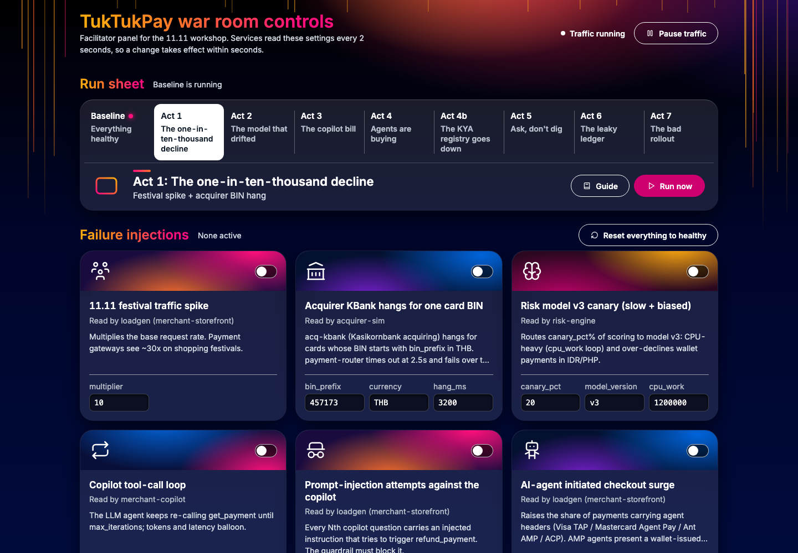
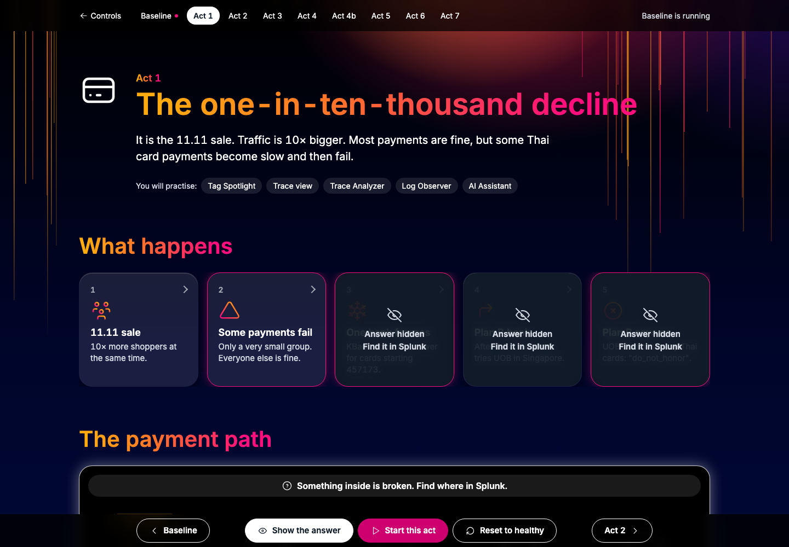
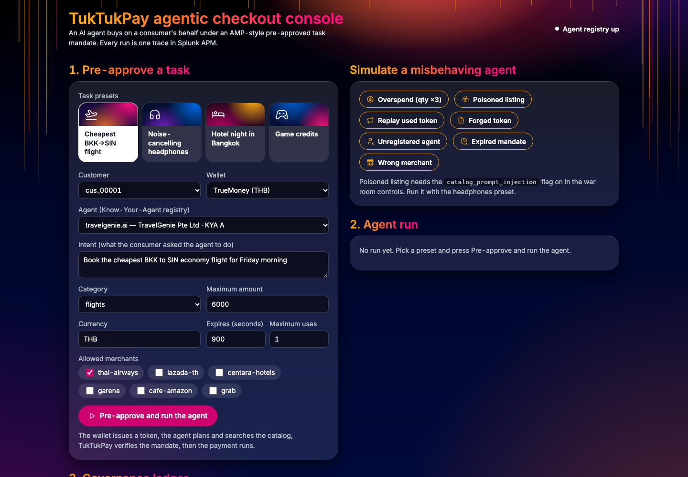
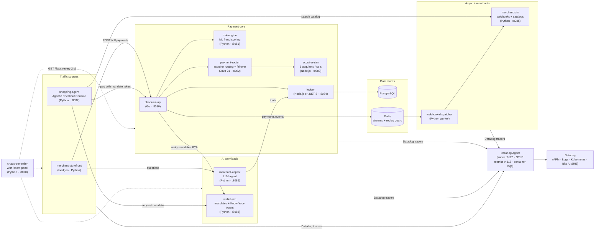
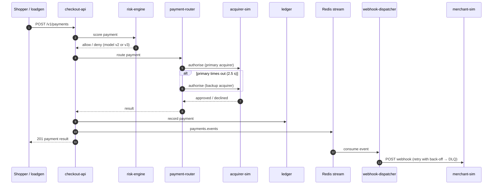

# TukTukPay — Datadog edition

> **Branch `tuktukpay-app-with-DD`.** Every service runs **Datadog's own tracer** and sends to the **Datadog Agent**, so
> Datadog sees the stack the way it sees a native Datadog customer — the setup **Bits AI SRE** is meant for. Setup,
> what changed and how to test Bits: [docs/datadog.md](docs/datadog.md). The OpenTelemetry + Splunk version is on `main`.

A fictional Bangkok-based **payment service provider (PSP)** built as a realistic, fully instrumented demo platform.
Eleven polyglot microservices — Go, Java, Node.js and
Python — process card, wallet and QR payments across six Southeast Asian currencies, route them to five simulated
acquirers, and include two AI workloads: an LLM **merchant copilot** and **AI shopping agents** that pay on a
consumer's behalf under wallet-issued spending mandates.

A built-in **War Room control panel** injects realistic failures (festival traffic spikes, a hanging acquirer, a
drifting fraud model, an AI tool-call loop, prompt injection, database contention…) so you can practise finding
root cause with traces, metrics, profiling, **logs** and AI-assisted troubleshooting.

Every service writes structured, trace-correlated JSON logs to stdout (`trace_id`, `dd.trace_id`, `service.name`,
business fields such as `payment.id`, `payment.acquirer`, `mandate.block_reason`); the Datadog Agent collects them
and links each line to its trace. See [docs/log-schema.md](docs/log-schema.md).

The reference deployment is **Kubernetes** — a local [kind](https://kind.sigs.k8s.io/) cluster in one command, or any
cluster such as EKS — with the Datadog Agent Helm chart (one Agent per node plus the Cluster Agent). Two acts exist only
there: a memory leak that gets the ledger OOMKilled and a bad rollout that crash-loops the wallet. Docker Compose
remains as a lighter alternative for laptops without the Kubernetes acts.

> **Everything is simulated.** TukTukPay is fictional. Real bank, wallet and merchant names are used only to make the
> scenario recognisable; every latency, approval rate, decline and outage is generated by this code and says nothing
> about how those companies perform. No real money, no real card data, no real PII.

### Screenshots

**War Room control panel** — <http://localhost:8090>: a run sheet across the top (pick an act, open its guide or run it) and one tile per failure injection below.



**Act guide** — <http://localhost:8090/act/act1>: picture-first explainer for each storyline, with the answer hidden until you find it (the page text still says Splunk; the evidence is in Datadog on this branch).



**Agentic Checkout Console** — <http://localhost:8087>: an AI shopping agent pays under a wallet-issued mandate; attack buttons simulate a misbehaving agent.



---

## Contents

1. [Architecture](#architecture)
2. [Services](#services)
3. [How a payment flows](#how-a-payment-flows)
4. [Quick start (Kubernetes) — step by step](#quick-start-kubernetes--step-by-step)
5. [Running the War Room scenarios](#running-the-war-room-scenarios)
6. [Alternative: Docker Compose](#alternative-docker-compose)
7. [Optional: real LLMs, .NET ledger, dual-shipping](#optional-real-llms-net-ledger-dual-shipping)
8. [Useful commands](#useful-commands)
9. [Logs and AI troubleshooting](#logs-and-ai-troubleshooting)
10. [Troubleshooting](#troubleshooting)
11. [Repository layout](#repository-layout)

---

## Architecture



**Key design choices**

* **Datadog tracers, OpenTelemetry API.** Each service runs Datadog's tracer (`ddtrace-run`, `dd-trace`,
  `dd-java-agent`, `dd-trace-go`); the code itself keeps using the OpenTelemetry API for business spans, attributes
  and the `tuktukpay.*` metrics, which the tracers map to Datadog (`DD_TRACE_OTEL_ENABLED`, `DD_METRICS_OTEL_ENABLED`).
* **A mix of instrumentation styles**, on purpose: OpenTelemetry API spans in Go, zero-code tracers for Java /
  Node.js / Python, and GenAI semantic conventions (`gen_ai.*`) for the AI services.
* **Business context on every span.** `merchant.id`, `payment.acquirer`, `payment.card.bin`, `payment.method`,
  `payment.currency`, `payment.initiator`, `risk.model_version`, `payment.decline_reason`, `agent.protocol`,
  `mandate.block_reason`… so you can slice errors and latency by business dimension.
* **One trace end to end** — including the async webhook delivery (trace context carried through Redis Streams) and
  the AI agent's LLM calls and tool calls.
* **Deterministic behaviour.** Approvals and declines are hashed from the payment id, so scenarios reproduce reliably.

---

## Services

| Service | Language | Instrumentation | Port | Role |
|---|---|---|---|---|
| [`checkout-api`](services/checkout-api/README.md) | Go 1.26 | OTel API on `dd-trace-go` | 8080 | Public payments API; verifies agent mandates |
| `risk-engine` | Python / FastAPI | `ddtrace-run`, zero-code | 8081 | ML fraud scoring (model v2, canary v3) |
| `payment-router` | Java 21 | `dd-java-agent` + one OTel API server span | 8082 | Picks the acquirer, fails over on timeout |
| `acquirer-sim` | Node.js / Express | `dd-trace`, zero-code | 8083 | 5 simulated acquirers / wallet / QR rails |
| `ledger` | Node.js + PostgreSQL | `dd-trace`, zero-code | 8084 | System of record (SQL spans) |
| `webhook-dispatcher` | Python worker | zero-code + consumer span | — | Delivers payment webhooks with retries + dead-letter queue |
| `merchant-sim` | Python / FastAPI | zero-code | 8085 | Merchants' webhook endpoints and product catalogs |
| `merchant-copilot` | Python / FastAPI | GenAI semantic conventions | 8086 | LLM agent answering "why did payment X fail?"; guardrails |
| `shopping-agent` | Python / FastAPI + web UI | GenAI semantic conventions | 8087 | Agentic Checkout Console: an AI agent buys under a mandate; attack buttons |
| `wallet-sim` | Python / FastAPI | zero-code | 8088 | Issues scoped task mandates; Know-Your-Agent registry |
| `loadgen` (`merchant-storefront`) | Python | root spans | — | Realistic regional traffic mix, festival spikes, agent checkouts |
| `chaos-controller` | Python / FastAPI | none (tooling) | 8090 | War Room panel + picture guides; `GET /flags` polled by all services |
| `datadog-agent` | Datadog Agent (Helm chart on Kubernetes, container on Compose) | — | 8126 / 8125 / 4318 | Receives traces, runtime metrics and OTLP metrics; collects container logs; sends to Datadog |
| `postgres`, `redis` | — | — | internal | Ledger database; event stream + mandate replay protection |

---

## How a payment flows



For an **AI agent payment**, the shopping agent first asks `wallet-sim` for a task mandate (which agent, max amount,
allowed merchants, expiry, single use), searches the merchant catalog, then pays with the mandate token.
`checkout-api` verifies the token, the limit, the merchant, expiry, replay and the agent's Know-Your-Agent rating
before the payment ever reaches risk scoring or an acquirer.

---

## Quick start (Kubernetes) — step by step

One script creates a local **kind** cluster, builds the images, installs the Datadog Agent Helm chart, and deploys
the stack. For an existing cluster (EKS, GKE, AKS, …) see
[k8s/README.md](k8s/README.md).

### Prerequisites

| Need | Notes |
|---|---|
| Docker Desktop (or Docker Engine) | Allocate **4 CPUs and 8 GB RAM**; kind runs the cluster as a container (`brew install kind`) |
| `kind`, `kubectl`, `helm` | `brew install kind kubectl helm` on macOS; any recent versions |
| Git | to clone the repo |
| A Datadog org | an **API key** (Organization Settings → API Keys) and your **site** (`datadoghq.com`, `us3.datadoghq.com`, `us5.datadoghq.com`, `datadoghq.eu`, `ap1.datadoghq.com`, `ap2.datadoghq.com`); an application key too if you create the monitors with Terraform |
| Internet access on first run | base images, packages, the Helm chart and the agent images (≈ 5–8 minutes) |

### Step 1 — Clone the repository

```bash
git clone https://github.com/khsydney/tuktukpay-app.git
cd tuktukpay-app
git switch tuktukpay-app-with-DD
```

### Step 2 — Create your `.env`

```bash
cp .env.example .env
```

Open `.env` and set at least these values:

```dotenv
DD_API_KEY=<your Datadog API key>
DD_SITE=datadoghq.com                    # your org's site, e.g. ap1.datadoghq.com
DEPLOYMENT_ENVIRONMENT=tuktukpay-dev     # becomes the Datadog env tag you filter on (one per team)
```

Everything else has working defaults (the AI services use an offline **mock** LLM, so no API key is needed).
`.env` is git-ignored — never commit it.

### Step 3 — Create the cluster and deploy

```bash
k8s/kind-up.sh                    # or: make k8s-up
```

What it does: creates the `tuktukpay` kind cluster, builds the images with Compose and loads them into the node,
installs the **Datadog Agent chart** ([`k8s/datadog-agent.sh`](k8s/datadog-agent.sh), values in
[`k8s/values-datadog.yaml`](k8s/values-datadog.yaml): APM, container logs, Kubernetes state, live processes, OTLP
metrics; the API key goes into a Secret), applies [`k8s/tuktukpay.yaml`](k8s/tuktukpay.yaml) into namespace
`tuktukpay` with the application settings from `.env` (ConfigMaps for the app and the Datadog tracer settings, a Secret, read through `envFrom`), and
waits for the rollout. First run ≈ 5–8 minutes; re-running it is safe (it rebuilds changed images and upgrades the
release).

**Changed `.env`?** Run `k8s/kind-up.sh` (or `make k8s-up`) again: Datadog values go to the Agent chart, the
application values to the ConfigMap/Secret, and the application pods are rolled when those changed. The same command
applies a code change: the images are rebuilt and loaded, and the deployments whose image actually changed are restarted
(a `chaos-controller` restart resets the flags and the traffic switch — start the act again afterwards).

### Step 4 — Check that everything is running

```bash
kubectl -n tuktukpay get pods     # every pod 1/1 Running
scripts/smoke-test.sh             # or: make smoke — sends payments + an agent payment + a copilot question
```

On kind the UI and API ports are published straight on `localhost` (NodePort services + the port mappings in
[`k8s/kind-config.yaml`](k8s/kind-config.yaml)), so nothing else has to run on the laptop. On a cluster without
such mappings use `k8s/port-forward.sh` (or `make k8s-forward`) for self-healing `kubectl port-forward` tunnels.
A successful smoke test prints health checks, a payment result with a `payment_id`, the ledger read-back and a
copilot answer.

### Step 5 — Open the web UIs

| URL | What it is |
|---|---|
| http://localhost:8090 | **War Room controls** — scenario presets, picture guides, individual failure flags, pause/resume traffic |
| http://localhost:8087 | **Agentic Checkout Console** — run an AI agent purchase and try the attack buttons |
| http://localhost:8080/healthz | checkout-api health |

### Step 6 — See the data in Datadog

1. **APM → Services**, filter `env:<your DEPLOYMENT_ENVIRONMENT>`. Within a minute or two the services appear and the
   **service map** shows `merchant-storefront → checkout-api → risk-engine / payment-router → acquirer-sim / ledger → …`.
2. Open any `POST /v1/payments` trace to follow one payment end to end; the **Logs** tab of the trace shows the log
   lines of that trace (linked through `dd.trace_id`), the **Infrastructure** tab the pod and node.
3. **Infrastructure → Kubernetes**: cluster `kind-tuktukpay`, namespace `tuktukpay` — pods, restarts, CPU and memory.
4. **Logs**: `service:checkout-api env:<env>`; the JSON fields (`@event`, `@payment.acquirer`, …) are facets.
5. **Monitors for Bits AI SRE**: create them with Terraform (one or more per act, every one tagged with its service):

   ```bash
   # DD_APP_KEY=<application key> in .env, then:
   make monitors-plan && make monitors-apply      # datadog/terraform
   ```

   Then turn on Bits AI SRE investigations for them — see [docs/datadog.md](docs/datadog.md#testing-bits-ai-sre).

### Step 7 — Stop or reset

```bash
make pause                        # stop simulated traffic but keep everything running (saves laptop CPU)
make resume                       # start traffic again
make reset                        # every failure flag off
kind delete cluster --name tuktukpay    # or: make k8s-down — removes the whole cluster
```

The traffic switch (top-right button of the panel, `make pause` / `make resume`) is separate from the failure flags: while it is
off, the load generator sends nothing, so **no act shows up in Datadog**. Starting an act — "Run now", "Start this act" or
`make act1` … `make act7` — therefore resumes traffic automatically and records it in the panel history ("traffic resumed
(start of act6)"); `make reset` and switching individual flags leave the switch alone. And keep the laptop awake: closing the
lid sleeps the Mac, which freezes the Docker Desktop VM and with it every pod — traces, metrics and logs all stop at once and
resume on wake. `make awake` runs `caffeinate` against idle sleep; a closed lid still sleeps the machine.

---

## Running the War Room scenarios

Open **http://localhost:8090**. **Guide** on each row of the run sheet opens a **picture guide** (diagram, what happens,
what to look for, the answer hidden until you reveal it). Press **Start this act** on the guide, or **Run now** on the row.

| Preset | What breaks | What you practise |
|---|---|---|
| `baseline` | nothing — everything healthy | learn what normal looks like |
| `act1` — The one-in-ten-thousand decline | 10× festival spike + one acquirer hangs for one card BIN → slow failover to a backup acquirer that declines | Tag Spotlight on business tags, failover inside a trace |
| `act2` — The model that drifted | fraud model v3 canary (20 %): CPU-heavy and over-declines wallets in IDR / PHP | approval rate by model version, AlwaysOn Profiling, AI troubleshooting |
| `act3` — The copilot bill | LLM copilot stuck in a tool-call loop + prompt-injection refund attempts | GenAI traces, token and cost metrics, guardrail events |
| `act4` — Agents are buying | 25 % agent traffic, mandate violations, a poisoned product listing | agent segmentation, mandate verification, end-to-end agent trace |
| `act4b` — The agent list goes down | Know-Your-Agent registry returns 503 → every agent payment fails closed | dependency incidents in AI governance |
| `act5` — Ask, don't dig | ledger connection pool shrinks + one merchant's webhook turns flaky | Database Query Performance, async retries in the same trace, AI Assistant |
| `act6` — The leaky ledger *(Kubernetes)* | the ledger retains memory until its 384 MiB limit → **OOMKilled** → restart loop; writes fail while it is down | Kubernetes alert → AI Troubleshooting Agent → **Remediation Plan**; `memory.pressure` logs |
| `act7` — The bad rollout *(Kubernetes)* | wallet-sim exits seconds after start as if a migration failed → **CrashLoopBackOff** → every agent payment fails closed | restart alert, the service's last log line, rollback as the plan |

Two more Kubernetes incidents are scripts rather than flags, because they are rollouts: `k8s/acts/oversize-rollout.sh`
(a pod no node can fit → Pending) and `k8s/acts/bad-image.sh` (ImagePullBackOff); `k8s/acts/rollback.sh <deployment>`
undoes them. Expected answers, evidence lines and AI prompts for every act: [docs/ai-troubleshooting.md](docs/ai-troubleshooting.md).

From the command line (the ports are published on `localhost` by kind):

```bash
make act1                                   # or: curl -X POST localhost:8090/scenarios/act1  (… act7)
make reset                                  # everything healthy again
make flags                                  # show current failure flags
```

Every flag can also be toggled individually (with parameters) on the controls page:
`festival_spike`, `acquirer_kbank_timeout`, `router_failover_disabled`, `risk_model_drift`, `copilot_tool_loop`,
`copilot_prompt_injection`, `agent_traffic_surge`, `agent_mandate_violations`, `catalog_prompt_injection`,
`kya_registry_down`, `ledger_db_slow`, `webhook_merchant_flaky`, `ledger_memory_leak`, `wallet_crash_loop`.

---

## Alternative: Docker Compose

The same stack runs under Docker Compose for laptops that cannot host a cluster. Everything works except the
Kubernetes-only acts (`act6`, `act7`, the rollout scripts) and the Remediation Plan, because there are no
Kubernetes alerts.

```bash
cp .env.example .env && $EDITOR .env      # same variables as above
docker compose up -d --build              # or: make up — first build ≈ 5–8 min
docker compose ps && scripts/smoke-test.sh
make pause / make resume / make reset     # same controls, same UIs on the same ports (no port-forward needed)
docker compose down -v                    # stop and wipe the database (or: make down)
```

Do not run both at once on one machine: they share the host ports and the laptop's memory.

---

## Optional: real LLMs

**Real LLM providers** — `mock | openai | anthropic | bedrock`, configured in `.env` for both deployments:

```dotenv
COPILOT_PROVIDER=openai          # mock | openai | anthropic | bedrock
COPILOT_MODEL=gpt-4o-mini
OPENAI_API_KEY=...               # or ANTHROPIC_API_KEY / AWS credentials + AWS_REGION
AGENT_PROVIDER=mock              # same options for the shopping agent
```

Then `make k8s-up` (Kubernetes: the keys land in the `tuktukpay-secrets` Secret and the pods are rolled) or
`docker compose up -d merchant-copilot shopping-agent` (Compose).

---

## Useful commands

```bash
kubectl -n tuktukpay get pods                            # state, restarts (watch them climb in act6/act7)
kubectl -n tuktukpay logs deploy/checkout-api -f         # follow one service's JSON logs
kubectl -n tuktukpay logs deploy/ledger --previous       # the last lines of a container that was OOMKilled
kubectl -n tuktukpay get events --sort-by=.lastTimestamp # OOMKilled, BackOff, FailedScheduling …
k8s/kind-up.sh && kubectl -n tuktukpay rollout restart deployment/<service>   # redeploy one service after a code change
curl -s -X POST localhost:8080/v1/payments -H 'Content-Type: application/json' -d @scripts/sample-payment.json
curl -s -X POST localhost:8086/v1/ask -H 'Content-Type: application/json' \
     -d '{"merchant_id":"thai-airways","question":"What is my approval rate right now?"}'
```

| Make target | Does |
|---|---|
| `make k8s-up` / `make k8s-down` | create or update the kind cluster + stack / delete the cluster |
| `make k8s-forward` | port-forward the UIs and APIs to localhost — only for clusters without kind's port mappings |
| `make smoke` | end-to-end smoke test against `localhost:8080` |
| `make pause` / `make resume` | stop / restart simulated traffic |
| `make baseline`, `make act1` … `make act7`, `make reset` | storyline presets |
| `make k8s-agent-status` / `make agent-status` | Datadog Agent status (APM, logs, OTLP, forwarder) on Kubernetes / Compose |
| `make datadog-agent` | (re)install only the Datadog Agent on the current kube-context |
| `make monitors-plan` / `make monitors-apply` | the Datadog monitors for Bits AI SRE (`datadog/terraform`) |
| `make awake` | keep the Mac from idle-sleeping during the session (`caffeinate`); a closed lid still sleeps it |
| `make up` / `make down` / `make ps` / `make logs` | the Docker Compose equivalents |

---

## Logs and AI troubleshooting

Every service writes one structured JSON log line per notable event — `payment.declined`, `acquirer.timeout`,
`risk.canary_inference`, `mandate.blocked`, `db.pool.wait`, `webhook.dead_lettered`, `config.changed` … — with
`trace_id`, `dd.trace_id`, `dd.span_id`, `dd.service`, `dd.env`, `dd.version` and the same business keys as the span
tags. The Datadog Agent collects container stdout (`containerCollectAll`), parses the JSON and links each line to its
trace, so a trace's **Logs** tab and **Bits AI SRE** both find the line that explains each incident: the
`acquirer.timeout` line for Act 1, `config.changed` + `risk.canary_inference` for Act 2, and so on.

| Doc | Content |
|---|---|
| [docs/datadog.md](docs/datadog.md) | Datadog setup, what each service runs, Bits AI SRE testing, limits |
| [docs/log-schema.md](docs/log-schema.md) | The common record layout and the event catalogue per service (with the smoking-gun line of each act) |

---

## Troubleshooting

| Symptom | Fix |
|---|---|
| Nothing appears in Datadog APM | `make k8s-agent-status` (Compose: `make agent-status`): the APM section must show traces received; check `DD_API_KEY` / `DD_SITE` in `.env` and that the service pods have `DD_AGENT_HOST` (the node IP) |
| Traces arrive but no logs are linked | Logs need `datadog.logs.containerCollectAll` (on in `k8s/values-datadog.yaml`) and JSON lines with `dd.trace_id`; check one line with `kubectl -n tuktukpay logs deploy/risk-engine --tail=1` |
| No `tuktukpay.*` metrics | They go over OTLP/HTTP to the Agent's 4318 (`DD_METRICS_OTEL_ENABLED=true`, `OTEL_EXPORTER_OTLP_ENDPOINT=http://$(DD_AGENT_HOST):4318`); the OTLP section of the Agent status must show the receiver on |
| An act is started but nothing changes in Datadog | Traffic was paused (amber pill top-right, banner on the panel): the acts only set failure flags, the load generator was idle. Starting an act now resumes traffic by itself; switching an individual flag does not — press **Resume traffic** |
| You see services but no new data | Traffic may be paused — check the pill on http://localhost:8090 or run `make resume` |
| The war-room panel or console stops responding | On kind the ports are direct (no tunnel): check `kubectl -n tuktukpay get pods` and that the cluster was created with `k8s/kind-config.yaml` (`docker port tuktukpay-control-plane` lists 8090…). With `k8s/port-forward.sh` tunnels on other clusters, run it again; the pages now show "controller unreachable" instead of freezing |
| Pods `Pending`, `ImagePullBackOff` or `CrashLoopBackOff` outside an act | `kubectl -n tuktukpay describe pod <pod>`; after a code change re-run `k8s/kind-up.sh` so the image is rebuilt and loaded into kind |
| Build is very slow or containers restart | Give Docker at least 4 CPUs / 8 GB RAM; on a small laptop use `make pause` between scenarios |
| Agent console: every run — presets and simulation buttons alike — ends in "agent  is not registered" with an **empty** agent | The page loaded its agent list while wallet-sim (the KYA registry) was down — Act 7 crash-loops it — and kept the empty list. The console now retries the registry every 5 s, offers the preset agents meanwhile and shows a banner; on an older page, reload once the wallet is back |
| Agent console runs end in "Wallet unreachable — the agent failed closed" (older build: `Error — Connection refused`) | Act 7 is running: the wallet *is* the KYA registry, so no mandate can be issued and the agent fails closed — that is the act. Reset it from the panel to get purchases again (under Act 6, payments can fail at the ledger write instead) |
| A gap of a few minutes in APM / traces right after a VPN or Wi-Fi change | kind's CoreDNS forwards to the laptop's resolver; while that resolver is switching, the collector logs `lookup ingest.<realm>… no such host` and drops spans after its retries. It recovers by itself — nothing to restart |
| `Cannot connect to the Docker daemon` / `kubectl` says `connection refused` on 127.0.0.1:<port> | Docker Desktop is not running (after a reboot it does not auto-start unless configured). `open -a Docker`, wait for the whale icon; the kind node container restarts by itself and the pods come back within ~2 min; then `k8s/kind-up.sh` to re-apply `.env` changes |
| Port already in use | Another process uses 8080–8090 or 4317/4318; stop it or change the host port in `k8s/kind-config.yaml` (needs a cluster recreate) / `docker-compose.yml` |
| A scenario seems to do nothing | Wait 10–30 s (services poll flags every 2 s; charts need data points) and confirm the flag is on at http://localhost:8090 |
| Start again from a clean state | `kind delete cluster --name tuktukpay && k8s/kind-up.sh` (Compose: `docker compose down -v && docker compose up -d --build`) |

---

## Repository layout

```
k8s/                          the reference deployment: kind-up.sh, tuktukpay.yaml (manifests), datadog-agent.sh + values-datadog.yaml,
                              port-forward.sh, acts/ (rollout incidents), README.md
docker-compose.yml            the Compose alternative (with a datadog-agent container)
.env.example                  configuration template — copy to .env
Makefile                      shortcuts (k8s-up, k8s-forward, smoke, act1…act7, pause, resume, agent-status, monitors-apply …)
services/<name>/              one folder per service, each with its own Dockerfile and structured logging
db/init.sql                   ledger schema + merchant seed data
datadog/terraform/            Datadog monitors (APM, logs, Kubernetes) for Bits AI SRE, as code
docs/                         Datadog setup and Bits AI SRE testing, log schema
scripts/                      smoke test + sample payloads
```
